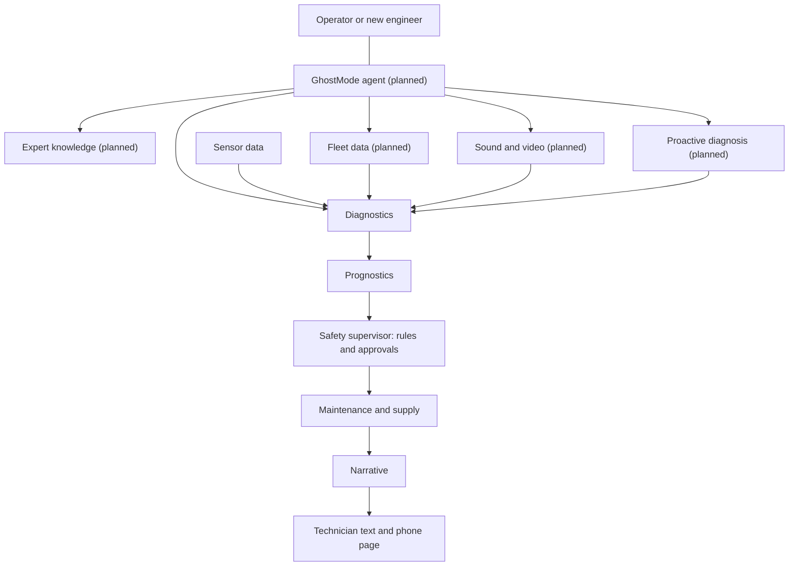

# GhostShift for data center failures

GhostShift is a multi agent system that listens to your data center equipment, understands what it is saying from sensor data, manuals, other sites' data, sound and video, and the knowledge of experienced engineers, and acts before the equipment fails.

> **Status.** The core pipeline and the demo are built and run **fully offline by default** (AWS, Twilio and ElevenLabs are optional). The GhostMode agent and four specialists marked **Planned** are a design and are not in the code yet. Setup, API and troubleshooting are in the main [README.md](README.md).

## The problem

A data center outage is rarely sudden. A fan bearing wears, a chiller heat exchanger fouls or a pump loses pressure, and temperatures drift for hours or days before an alarm limit trips. By then the choice is an emergency repair, thermal throttling or an outage. Alarms fire only at fixed limits, the engineer who knows what a strange noise means may be retiring, every site relearns the same failures, and many early warnings (a grinding fan, a drip, a hot spot) never reach a sensor.

## The GhostMode agent

The **GhostMode agent** is the one agent a person talks to. It takes a question or a new problem, decides which specialists to call, combines their results and explains the answer in plain words, with its sources and the list of specialists it used.

It delegates and does not decide. It has no tool to approve, reject or execute an action, change a priority or send a message, so tiers, approvals and lockout/tagout stay in code. It would run on Bedrock tool use (design in [docs/workstreams/1-agentic-copilot.md](docs/workstreams/1-agentic-copilot.md)).

## Specialist agents

All planned agents are **advisory**: they add evidence and answers, and cannot change priority, approvals or lockout/tagout, order parts or release work.

| Agent | What it does | Status |
|---|---|---|
| Diagnostics | Compares readings with baseline and alarm limits, matches known fault patterns, keeps evidence references | Built |
| Prognostics | Failure-risk score and time to the danger limit as a range, only when the trend is clear | Built |
| Safety supervisor | Sets priority and required approvals in deterministic code | Built |
| Maintenance & supply | Picks the part, proposes the earliest fitting downtime window, drafts the work order | Built |
| Narrative | Writes the incident summary, optionally reworded by Bedrock under validation | Built |
| **Expert knowledge** | Gives a new engineer the judgement of a 30-year veteran. Answers "why was this flagged?" and "what should I check first?" from manuals, past incidents and veteran notes, naming the source | Planned |
| **Proactive diagnosis** | Scans every asset, ranks them by drift from their own baseline and time to limit, and opens problems early | Partly built (single asset works; estate-wide scan planned) |
| **Fleet data** | Reads datasets from other companies' similar data centers and compares failure patterns, lead times and fixes. Context only: it never sets your limits | Planned |
| **Sound and video** | Turns audio, video and photos (fan noise, a drip, a hot spot) into labelled findings that join the diagnosis | Planned |

## Demo

The bundled demo has two simulated machines that stand in for data center equipment. This mapping is an analogy: the screens and fixtures still use the names `VMC-07` and `CMP-02`.

| Demo machine | Fault shown | Data center equivalent |
|---|---|---|
| `VMC-07` | Bearing degradation: vibration, bearing temperature, motor current | Cooling fan or chiller compressor bearing wear |
| `CMP-02` | Oil-cooler fouling: oil and discharge temperature, oil level | Chiller or heat-exchanger fouling |

Run `make setup` then `make dev`, and open http://localhost:5173 (see [Quick start](README.md#quick-start)). About 3 minutes:

1. **Normal.** `VMC-07` runs inside its normal ranges.
2. **Early drift.** Press *Play*. Vibration leaves its normal range and GhostShift opens a problem at **Medium** priority. *Why it was flagged* shows the readings and the matching fault pattern. No alarm limit has been crossed.
3. **Text before the alarm.** Press *Play* again. Time to the danger limit drops under 72 h, priority goes to **High**, and the technician gets a text with a link to a phone page.
4. **Fix and approvals.** The bearing set is in stock and the planned downtime comes before the limit. Approve the part order. Approving the work order without the lockout/tagout box ticked is refused by the backend.
5. **Autopilot (optional).** Turn on **Autopilot** and replay. It places the order itself within a spending limit. The lockout/tagout sign-off always stays with a person.
6. **Second machine.** Select `CMP-02` and press *Skip to fault*. The in-stock cleaning kit beats a replacement core with a 3-day lead time, and GhostShift warns that the next planned downtime may be too late.

## Real and simulated

| Item | Status |
|---|---|
| Telemetry, stock, lead times, orders, work orders | **Simulated**. No data center data is bundled |
| Diagnostics, risk, remaining useful life, safety tier | **Deterministic code** on the simulated data. The life estimate is a linear trend, not validated |
| SMS, narrative | Simulated by default. **Real Twilio** and **real Bedrock** when configured |
| GhostMode agent and the four planned specialists | **Not built** |

## Safety

- Tiers and approvals are code. An LLM cannot change them, and narratives claiming equipment is safe or isolated are rejected.
- Approvals authorise a record in GhostShift. They do not stop, isolate or make equipment safe.
- Work-order approval requires attesting that isolation will be done and verified by qualified personnel under the site lockout/tagout procedure.
- Every finding names its source (sensor, fleet dataset, sound, video, photo or document), and a failed provider shows as a failure, never a success.
